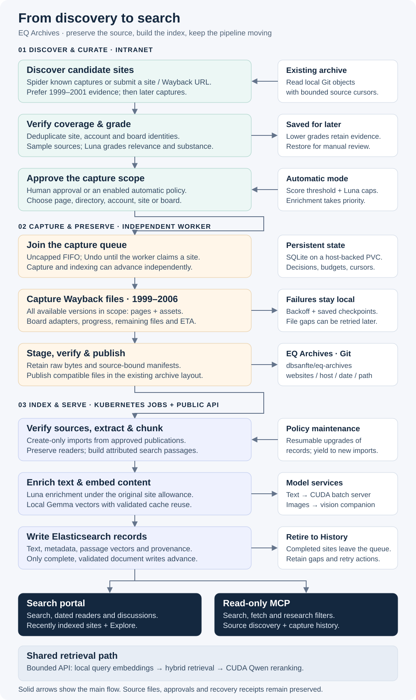

# EQ Archives Software

Search, explore and preserve the early EverQuest web: guild sites, class guides,
item databases, forums, personal pages, mailing lists and newsgroups. This
repository contains the public search portal, a read-only MCP server for AI
assistants, an intranet curation pipeline, and the indexing and GPU inference
services behind them.

**[Search the archive](https://search.eqarchives.org)** ·
**[Connect an AI assistant](https://search.eqarchives.org/mcp.html)** ·
**[Browse the archived content on GitHub](https://github.com/dbsanfte/eq-archives)**

The preserved files live in **[dbsanfte/eq-archives](https://github.com/dbsanfte/eq-archives)**.
This software repository turns those files into searchable, source-linked records
and helps discover and preserve additional sites.

## Search portal

The mobile-friendly [search portal](https://search.eqarchives.org) combines
keyword retrieval with **EmbeddingGemma semantic search**, then uses
**Qwen3-Reranker** to order the most relevant candidates. Hybrid retrieval is the
default for ordinary relevance searches; quoted phrases, query operators and
date sorting retain their lexical constraints.

- **Find historical sources:** filter by site, date, file type,
  mailing list, themes and tags. Search text, OCR and indexed images.
- **Read and cite:** open extracted documents, follow original/archive links,
  download sources and share stable reader URLs. Generated summaries and OCR are
  labelled separately from source text.
- **Follow a discussion through time:** related forum captures group into
  expandable results when their discussion identity is supported by source
  evidence. Choose a dated capture or compare page versions.
- **Browse recent additions:** [Recently indexed](https://search.eqarchives.org/sites)
  lists domains with recent indexing activity; tapping one scopes search to it.
- **Explore the collection:** [Explore](https://search.eqarchives.org/explore)
  links timelines, themes, distinctive phrases and site charts to focused searches.
  Charts disclose their sampling and counting limits.

The frontend is React with Elastic Search UI and Material UI. A bounded, read-only
API serves both browser search and MCP over Elasticsearch. The browser and NGINX
receive no database or model credentials, and callers cannot submit arbitrary
Elasticsearch queries. Query embeddings run locally on Vulkan; reranking uses the
private CUDA service below. Public searches make no paid Luna calls.

## MCP: the archive as a research tool

Connect a compatible assistant to **`https://search.eqarchives.org/mcp`** using
Streamable HTTP, with **no authentication**. See the
[connection guide](https://search.eqarchives.org/mcp.html) for ChatGPT and Claude
setup. No OpenAI API key is needed to query this server.

| Tool | Purpose |
| --- | --- |
| `search` | Find the best matching sources for a research question |
| `fetch` | Retrieve an exact record's extracted text, metadata and citation link |
| `search_archive` | Page through results with filters, sorting, grouping and optional keyword-only retrieval |
| `list_sources` | Discover available domains, lists, collections, file types, themes and tags |
| `list_sites` | Find recently indexed domains and their capture/indexing dates |
| `list_captures` | Browse dated versions of a page or verified discussion |

Research queries can combine capture, publication and indexing date windows;
scope a host, directory, exact page or Ezboard; and filter for text, OCR or
enrichment. Capture dates and indexing dates are distinct. Discussion grouping
falls back to pages when evidence is insufficient. Full-text retrieval preserves
source text and fails explicitly if it exceeds the response bound.

The [MCP guide](elastic-indexer-stack/mcp/README.md) documents the exact contracts,
filters, grouping limits, transport bounds and development tests.

## Curation: from a discovered link to a searchable site

The curation portal is an **intranet-only**, mobile-friendly workspace. It accepts
actual LAN clients in `192.168.0.0/16`, needs no authentication, and has no public
ingress. Discovery, capture and indexing have independent workers, with persistent
SQLite state and budget ledgers on a host-backed Kubernetes volume.



[Open the full-size pipeline diagram](docs/curation-indexing-pipeline.svg).

1. **Discover and assess.** Spider links from known archive captures or submit a
   site/Wayback URL manually. Verify archive coverage and deduplicate site,
   shared-account and board identities, including common `www` and default-port
   aliases. Sample source evidence and ask Luna to grade EQ relevance and archival
   substance, optionally against operator-defined criteria.
2. **Approve a scope.** Review a site and choose its page, directory, account,
   whole-site or supported board scope. Approved sites enter an uncapped FIFO
   queue; Undo remains available until they are claimed. Discovery prioritizes
   1999–2001 evidence, followed by later captures.
3. **Capture the site.** Download all available dated versions within the approved
   scope from **1999 through 2006**, including pages, images, stylesheets and other
   files. Ezboard and SitePowerUp have board-aware acquisition. The persistent
   Wayback connection uses bounded backoff and saves resumable progress.
4. **Preserve and publish.** Stage exact sources and manifests privately, then
   publish compatible files to the archive using its existing
   `websites/<host>/<timestamp>/<decoded path>` convention. Publication and indexing
   follow the original capture approval automatically, without a second review gate.
5. **Index and retire.** Kubernetes import Jobs verify source identity, extract and
   chunk content, enrich text with Luna, generate local embeddings and write new
   records to Elasticsearch. Completed sites leave the active portal for History,
   where remaining file gaps can be retried.

**Full auto mode** continuously discovers, grades and promotes qualifying sites
under a saved minimum score and daily/monthly Luna limits. Lower-scored sites stay
in Saved for later. Enrichment has priority over discovery; paid work resumes when
budget is available. Budgets, source decisions and paid caches survive retries.
Automatic mode requires explicit opt-in and is never enabled by deployment.

Failures are isolated: temporary transport/database contention retries with
backoff while other sites advance. A bad supporting URL or conflicting filename
becomes a visible gap, with downloaded bytes retained privately. Changed approvals,
stale grading evidence and integrity failures remain visible for correction.
Discovery reads local Git objects with bounded cursors, avoiding repeated archive
clones and full filesystem walks; publication groups files by site.

See the [curation guide](elastic-indexer-stack/curation/README.md) for operations,
budgets and recovery, or the [crawler guide](scripts/archive-crawler/README.md)
for standalone discovery and staging.

## Indexing and content-aware passages

The indexer preserves original files and full reader text while creating a
separate, source-bound search representation. Shared policies recognize forum
posts, quotations, feeds, articles and data tables. Major structured collections
such as Allakhazam, Everlore, EQ Traders and Magelo have dedicated adapters;
unknown layouts retain content conservatively. Japanese and mixed legacy
encodings share the same decoder across discovery and ingestion.

Text passages use a pinned tokenizer, a **480-token request budget** including
title/context, and roughly **48 tokens of overlap**. Author, date, section and
table context travel with the relevant passage. Proven navigation, advertising
and generated error layouts are excluded from semantic text without deleting
their archived sources. EmbeddingGemma produces **768-dimensional vectors**;
a separate vision companion embeds supported raster images in the same space.

New text imports add Luna summaries, tags and other enrichment by default, under
the site's cumulative allowance and shared spending limits. Images and routine
chunking/model backfills make no paid Luna calls. A bounded embedding cache keeps
frequently reused inputs longer and expires idle entries; its identity includes
the full input, model/runtime and tokenizer.

**Policy maintenance runs in bounded, resumable curation slices**, yielding to
new imports. It upgrades older records and reuses vectors only when the exact
source, passage plan and model request match. Existing enrichment, provenance,
dates and checkpoints are preserved. Broad model migrations and source-repair
Jobs remain explicit operator workflows with their own recovery procedures.

The [indexer guide](elastic-indexer-stack/indexer/README.md) covers backend setup
and the legacy RabbitMQ finder/consumer path. The
[Jobs guide](elastic-indexer-stack/indexer/k8s/README.md) and
[embedding runbook](scripts/embedding-service/README.md) cover current imports,
migrations, passage policies, images and recovery.

## CUDA batch inference

[`scripts/cuda-batch-server`](scripts/cuda-batch-server/README.md) is the project's
specialized HTTP inference server for **EmbeddingGemma 2** and
**Qwen3-Reranker 0.6B**, tuned for the **RTX 3080 Laptop GPU (SM86)**. It serves new
curation imports and policy maintenance, plus portal/MCP reranking. Live query
embeddings remain on eqvm's Vulkan service.

### Architecture

- **One complete layer per kernel launch.** Cooperative CUDA megakernels fuse
  normalization, Q/K/V projections, RoPE, attention, residuals and the feed-forward
  network: 24 layer launches for Gemma, 28 for Qwen. Input preparation and final
  pooling/classification use PyTorch; a full request includes that additional work.
- **Tensor Cores and register locality.** CUTLASS/WMMA paths use vectorized memory
  access, shared-memory tiles and FP32 accumulators. Pinned Q8_0 GGUF weights are
  dequantized to FP16 for compute. Compiler and disassembly checks reject spills,
  stack frames and local-memory accesses in the selected custom kernel profiles.
- **Fused causal attention.** Qwen streams attention tiles with online softmax,
  avoiding quadratic score/probability workspaces. Exact causal prefix blocks can
  share work within a batch; bidirectional Gemma retains its full attention context.
- **Continuous batching.** Independent model queues, worker threads and CUDA
  streams combine compatible inputs from concurrent HTTP requests. Whole inputs
  retain their attention context and response indexes. Short reranks receive
  scheduling priority with bounded fairness for bulk embeddings.
- **Clients submit useful batches.** Imports and maintenance send eight embedding
  inputs per request with up to four requests in flight. Portal/MCP share four
  concurrent reranking batch slots, with up to 20 passages per request.

The private API offers OpenAI-compatible **`POST /v1/embeddings`**, a
Qwen/llama.cpp-compatible **`POST /v1/rerank`**, and **`GET /health`**. Reranking is
an extension, not an OpenAI-standard endpoint. Bearer keys, bounded inputs,
per-model admission limits, deadlines and complete output validation protect the
service; it has no public ingress.

### Measured improvements over llama.cpp

The following measurements use the same RTX host and a small, source-linked
six-query archive fixture. Latencies are HTTP medians; bulk throughput uses
128 distinct embedding inputs at eight inputs × four concurrent requests.

| Workload | llama.cpp | CUDA batch server | Improvement |
| --- | ---: | ---: | ---: |
| Single embedding, per-query GPU warmup | 6.8 ms | 5.1 ms | 25% lower latency |
| Single embedding, without per-query warmup | 17.9 ms | 11.0 ms | 39% lower latency |
| Bulk text embeddings | 81 inputs/s | 113 inputs/s | 40% higher throughput |
| One top-20 reranking | 331 ms | 270 ms | 18% lower latency |
| Two concurrent top-20 rerankings, both complete | 750 ms | 616 ms | 18% lower latency |
| One top-60 reranking | 1,028 ms | 830 ms | 19% lower latency |
| Two concurrent top-60 rerankings, both complete | 2,151 ms | 1,714 ms | 20% lower latency |

These are model-service measurements, not full search-response or indexing rates.
Single-input results use 18 samples per backend with warmup and 36 without;
reranking uses 12 alternating paired repetitions. GPU clocks, lengths and traffic
mix matter. The FP16 compute path is **not numerically equivalent** to llama.cpp's
Q8 arithmetic: the strict absolute-score diagnostic still fails at about 0.048
maximum difference, although top-10 set overlap was 100% on this top-60 fixture.
That small comparison does not establish corpus-wide relevance equivalence.

The [CUDA guide](scripts/cuda-batch-server/README.md) details the benchmarks,
independent numerical checks, zero-spill gates, Nsight/compute-sanitizer workflow,
mixed-load tests and rollback. Exact runtime pins live in
[`deployment.env`](scripts/cuda-batch-server/deployment.env).

## Development and deployment

Clone this software repository to work on the application; the much larger
content repository is a separate dependency for ingestion.

```bash
git clone https://github.com/dbsanfte/eq-archives-software.git
cd eq-archives-software/elastic-indexer-stack/frontend
# Use Node.js 22 and Yarn Classic 1.22.22.
yarn install --frozen-lockfile --non-interactive
yarn start
```

The frontend development server runs on `localhost:3000`; working search also
needs the API/proxy and index described in the frontend guide.

| Component | Guide |
| --- | --- |
| React portal, tests and browser regressions | [Frontend](elastic-indexer-stack/frontend/README.md) |
| Public read-only API and MCP | [MCP service](elastic-indexer-stack/mcp/README.md) |
| Intranet curation, publication and import Jobs | [Curation](elastic-indexer-stack/curation/README.md) |
| Extraction, legacy workers and environment variables | [Indexer](elastic-indexer-stack/indexer/README.md) |
| Reindexing, maintenance and recovery Jobs | [Kubernetes Jobs](elastic-indexer-stack/indexer/k8s/README.md) |
| Model serving, passage policies, images and cache | [Embedding service](scripts/embedding-service/README.md) |
| CUDA kernels, batching and performance checks | [CUDA batch server](scripts/cuda-batch-server/README.md) |
| Retrieval calibration and model-judged evaluations | [Search benchmarks](scripts/search-benchmark/README.md) |
| Production prerequisites, secrets and rollback | [Deployment](elastic-indexer-stack/k8s-manifests/README.md) |

The [CI/CD workflow](.github/workflows/elastic-indexer-stack-cicd.yml) runs unit,
coverage, container, security and real-browser checks. Protected pull requests
retain the **Test and build frontend** check. README-only changes (any
`README.md` path) skip builds and deployment after lightweight scope and status checks;
draft PRs skip runner jobs and start validation when marked ready for review.
Other merges to `master` publish immutable images and deploy the portal, API,
curation and live embedding configuration to **k3s**. The CUDA runtime has its own
validated installation and pinned image.
Elasticsearch data and existing indexing Jobs retain their separate lifecycles.
README-only changes publish no image or new live build SHA. A pending tested
code deployment can still finish; manual dispatch requests fresh validation.

## Contributing and license

Open an [issue](https://github.com/dbsanfte/eq-archives-software/issues) or a pull
request against `master`. Follow [AGENTS.md](AGENTS.md) for the repository's
development, testing and delivery conventions. Keep credentials, captured private
fixtures and generated model data out of Git.

The software is **AGPL-3.0-only**; see [LICENSE](LICENSE). Elastic's original
Apache-2.0 notices are preserved in the frontend's
[NOTICE](elastic-indexer-stack/frontend/NOTICE.txt) and
[upstream license](elastic-indexer-stack/frontend/licenses/Elastic-Apache-2.0.txt).
Third-party dependencies retain their own licenses, including
[CUTLASS](scripts/cuda-batch-server/third_party/CUTLASS-LICENSE.txt).
The software license does not grant rights to archived content, EverQuest names,
logos or other third-party artwork.
